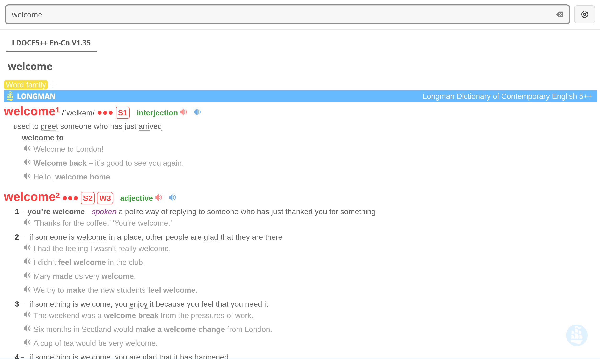

<p align="center"></p>

<h1 align="center">Dicto</h1>

<p align="center">A fast, offline desktop dictionary for Windows and Linux built in Rust. Reads MDX/MDD dictionary files — the same format used by GoldenDict, MDict, and most popular dictionary packs.</p>



## Installation

### Arch Linux

Download `dicto-*-x86_64.pkg.tar.zst` from the
[releases page](https://github.com/shellingfff/dicto/releases/latest), then install it:

```bash
sudo pacman -U ./dicto-*-x86_64.pkg.tar.zst
```

### Windows

Download from the [releases page](https://github.com/shellingfff/dicto/releases/latest):

| File | Description |
| ---- | ----------- |
| `dicto-*-windows-x86_64-installer.exe` | Recommended NSIS installer |
| `dicto-*-windows-x86_64-portable.zip` | Portable executable |

The installer checks for Microsoft Edge WebView2 and runs its embedded
bootstrapper when the runtime is missing. Installing the missing runtime
requires internet access. The portable ZIP does not install WebView2; install
that runtime separately before running it. The
[Visual C++ Redistributable](https://aka.ms/vs/17/release/vc_redist.x64.exe)
may also be needed on a clean Windows installation.

If upgrading from the old Inno Setup installer, uninstall that version first.
The new installer uses a different installer registration.

### From source

```bash
make linux
# binary at target/release/dicto
sudo make install
```

This installs the binary, desktop launcher, icon, and license under `/usr/local`.
To install for your user without sudo, run `make install PREFIX="$HOME/.local"`
after building, and ensure `~/.local/bin` is in your `PATH`.
Repeat the build and install commands to update. Linux installs use the application
ID `io.github.shellingfff.dicto` for the launcher and icons, matching the GTK
window ID. The GTK program name also matches this ID so Plasma can associate
Wayland windows with the launcher. Installation refreshes available desktop/icon caches and replaces the
old `dicto.desktop` launcher. After upgrading, quit and reopen Dicto; if it was
pinned in GNOME, remove the old favorite and pin the new launcher. Packaging can use
`make install DESTDIR=/path/to/staging PREFIX=/usr`.

**Linux dependencies:** WebKitGTK 4.1, GTK 3, and libappindicator. On Arch:

```bash
sudo pacman -S --needed base-devel rust webkit2gtk-4.1 libayatana-appindicator gst-plugins-good
```

GStreamer (`gst-plugins-good`) supplies the audio sink and common pronunciation
codecs; `gst-plugins-bad` adds other formats. Windows requires the WebView2 runtime.
Use `cargo run -p dicto` for development; the static frontend is embedded into
the binary by Tauri. `make check` runs backend tests and JavaScript syntax checks.


## Supported formats

| Format | Status |
| ------ | ------ |
| MDX v2 (UTF-8, UTF-16) | ✓ Full support |
| MDX v1 | ✓ Full support |
| MDD resource containers | ✓ Images, audio, CSS |
| Encryption level 0, 2 | ✓ Supported |

## References

- [mdict-analysis](https://bitbucket.org/xwang/mdict-analysis) — MDX/MDD format specification
